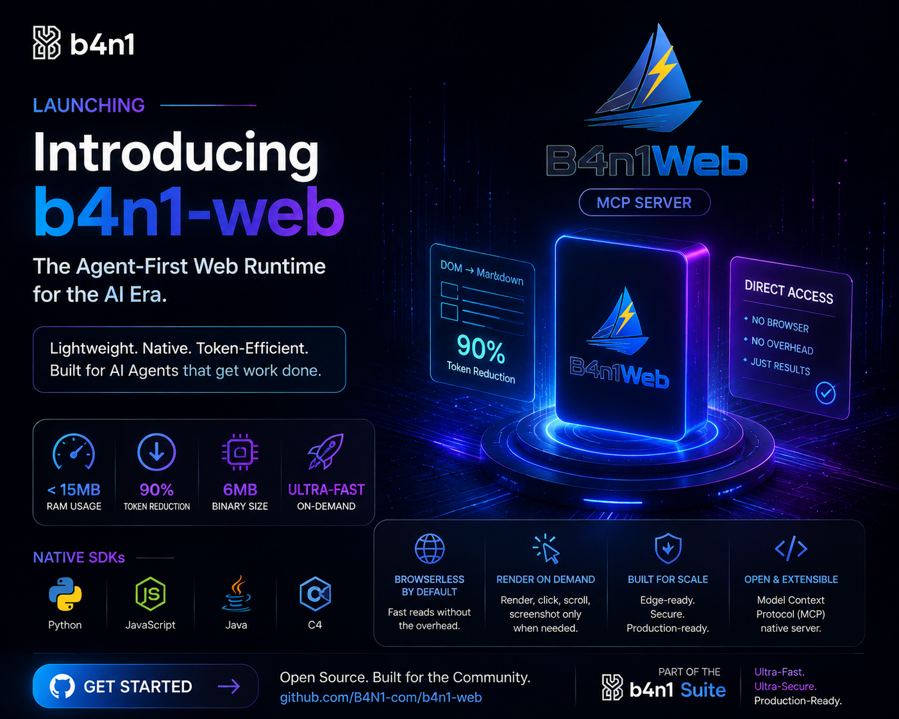

<div align="center">



# 🌐 B4n1Web — Motor de Navegación Agéntico

**Navegador headless ultraligero para agentes de IA.**

[](LICENSE)
[](https://pypi.org/project/b4n1-web/)
[](https://www.npmjs.com/package/b4n1-web)
[](https://www.nuget.org/packages/B4n1Web)
[](https://central.sonatype.com/artifact/com.b4n1/b4n1-web)
[](https://B4N1-com.github.io/b4n1-web/book/)

[](https://pypi.org/project/b4n1-web/)
[](https://www.npmjs.com/package/b4n1-web)
[](https://www.nuget.org/packages/B4n1Web)
[](https://github.com/B4N1-com/b4n1-web/releases)
[](https://github.com/B4N1-com/b4n1-web/releases)

Un solo binario autocontenido · 7 SDKs de lenguaje · 35 herramientas MCP.
Navega URLs, extrae contenido estructurado (markdown, enlaces, capturas) y construye flujos de trabajo autónomos para agentes.

</div>

---

## 🌍 Languages / Idiomas / 语言

|  |  |  |  |  |  |
|--|--|--|--|--|--|
| 🇬🇧 [English](../README.md) | 🇪🇸 [Español](i18n/README.es.md) | 🇫🇷 [Français](i18n/README.fr.md) | 🇩🇪 [Deutsch](i18n/README.de.md) | 🇵🇹 [Português](i18n/README.pt-BR.md) | 🇮🇹 [Italiano](i18n/README.it.md) |
| 🇨🇳 [简体中文](i18n/README.zh-CN.md) | 🇯🇵 [日本語](i18n/README.ja.md) | 🇰🇷 [한국어](i18n/README.ko.md) | 🇷🇺 [Русский](i18n/README.ru.md) | 🇸🇦 [العربية](i18n/README.ar.md) | 🇮🇳 [हिन्दी](i18n/README.hi.md) |

---

## 🖥 Platform Support

6 pre-compiled binaries — works everywhere:

| Platform | Architectures | Binary |
|----------|---------------|--------|
| **Linux** | x86_64, aarch64, i686 | static (no system libraries) |
| **macOS** | x86_64, arm64 | one per architecture |
| **Windows** | x86_64 | native |

## Características

- **35 MCP tools** — integración con agentes de IA
- **Single self-contained binary** ~11MB, no runtime dependencies
- **7 language SDKs** (Python, JavaScript/TypeScript, Java, C#, Ruby, PHP, Go) with bundled binary
- **Fully static** — works on any Linux, no system libraries required
- **Three modes**: Light (instant), JS (scripts), Render (Chromium)
- **Security shield**: domain filtering, safe browsing
- **Network interception**: block resources, mock responses
- **MCP Server**: stdio transport, no port needed
- **Extracción de enlaces**: herramientas MCP get_links + getLinks() en cada SDK (captura directa sin instancia de navegador)
- **Flag --licenses**: imprime la licencia incluida + avisos de terceros, sin clave

## Modos del Navegador

| Modo | Descripción | RAM | Arranque |
|------|-------------|-----|---------|
| Light | Descarga HTTP + parseo de HTML | ~15MB | Instant |
| JS | Light + extracción de JavaScript | ~15MB | Instant |
| Render | Chromium completo + capturas | ~100MB | ~2s |

## Inicio Rápido

Instala el binario o usa tu gestor de paquetes preferido:

```bash
# Binario (Linux, macOS, Windows — sin dependencias)
curl -sL https://raw.githubusercontent.com/B4N1-com/b4n1-web/master/scripts/install.sh | bash

# O mediante gestores de paquetes
pip install b4n1-web
npm install b4n1-web
dotnet add package B4n1Web
# Java: añade la dependencia desde Maven Central
```

Uso básico:

```python
from b4n1web import AgentBrowser

browser = AgentBrowser()
page = browser.goto("https://example.com")
print(page.markdown)
browser.close()
```

### Servidor MCP

```bash
# modo stdio (por defecto)
b4n1web mcp
npx b4n1-web mcp
uvx b4n1-web mcp
```

## Matriz de SDKs

| Lenguaje | Package | Version | Binario |
|----------|---------|---------|--------|
| Python | `b4n1-web` | 0.16.3 | Integrado |
| JavaScript/TypeScript | `b4n1-web` | 0.16.3 | Integrado |
| Java | `com.b4n1:b4n1-web` | 0.16.3 | Integrado |
| C# (.NET) | `B4n1Web` | 0.16.3 | Integrado |

## Documentación

- [📖 Documentación completa](https://B4N1-com.github.io/b4n1-web/book/) — mdBook
- [Herramientas MCP](https://mcp.so/server/b4n1web/B4N1-com) — MCP registry

## Links

- Website: https://b4n1.com
- GitHub: https://github.com/B4N1-com/b4n1-web
- PyPI: https://pypi.org/project/b4n1-web
- npm: https://www.npmjs.com/package/b4n1-web
- NuGet: https://www.nuget.org/packages/B4n1Web
- Maven Central: https://central.sonatype.com/artifact/com.b4n1/b4n1-web

## License

Business Source License 1.1 (BUSL-1.1)
